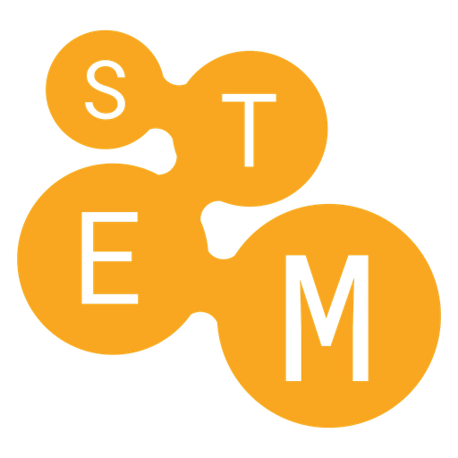

<p align="center">
  
</p>

<h1 align="center">STEM_HUB kvízy</h1>

<p align="center">
Kvízový systém pro živé akce <a href="https://stemhub.cz">STEM Hub</a>. Hráči se připojí kódem z mobilu a soutěží naživo nebo vlastním tempem.
</p>

---

## Co aplikace umí

- **Živý kvíz s moderátorem**: admin spustí kvíz a ukáže kód a QR, hráči se připojí a otázky postupují společně. Body se dávají za rychlost a za sérii správných odpovědí, pořadí se ukazuje průběžně.
- **Režim „vlastním tempem“**: hráči začnou hrát hned po připojení, bez čekání na moderátora. Čas měří server a po každé otázce hráč vidí, jak odpověděl. Admin sleduje tabulku hráčů a kvíz ukončí.
- **Tvorba kvízů**: otázky přes formulář nebo import z CSV (i víc souborů najednou). Typy otázek jsou výběr z možností, anketa, kód a obrázky. Návod k CSV: [docs/csv-formatting-guide.md](docs/csv-formatting-guide.md).
- **Přehledy a výsledky**: konečné pořadí, rozbor odpovědí po otázkách a historie odehraných kvízů.
- **Sdílení kvízů** mezi adminy s nastavením oprávnění.
- **Vše lokálně**: žádné cloudové služby, AI ani přihlášení přes Google. Obrázky se ukládají přímo v PostgreSQL.
- **Česky**: celé rozhraní i hlášky serveru.

## Technologie

| Část | Technologie |
| --- | --- |
| Frontend (`app/`) | Nuxt 3, Vue 3, Pinia, Tailwind CSS v4, shadcn-vue (reka-ui), ikony lucide |
| Backend (`api/`) | Go, Fiber, goqu, websockety |
| Databáze | PostgreSQL (migrace přes sql-migrate) |
| Cache / pub-sub | Redis |
| Přihlašování | Ory Kratos (e-mail a heslo) |
| E-maily lokálně | Mailpit |

## Rychlé spuštění (Docker)

Stačí mít nainstalovaný Docker.

```bash
git clone https://github.com/Mirek321/jovVix-stemQuiz.git
cd jovVix-stemQuiz
docker compose up --build
```

| Služba | Adresa |
| --- | --- |
| Aplikace | http://127.0.0.1:5000 |
| API a Swagger | http://127.0.0.1:3000/api/v1/docs |
| Mailpit (ověřovací e-maily) | http://127.0.0.1:8025 |

Po registraci potvrď e-mail v Mailpitu. Aplikaci otevírej na `127.0.0.1`, ne na `localhost`, protože na tuhle adresu jsou nastavené cookies Kratosu.

## Vývoj ze zdrojáků

Potřebuješ Node.js 18+, Go 1.23+ a Docker (spouští Postgres, Redis, Kratos a Mailpit).

```bash
# prostředí
cp api/.env.example api/.env
cp app/.env.example app/.env

# backend
cd api
docker compose up -d        # Postgres, Redis, Kratos, Mailpit
go run app.go migrate up
go run app.go api           # http://127.0.0.1:3000

# frontend (v druhém terminálu)
cd app
npm install
npm run dev                 # http://127.0.0.1:5000
```

Dev server Nuxtu je při prvním otevření každé stránky pomalý. Na rychlé proklikání je lepší produkční build:

```bash
cd app
npx nuxt build
node .output/server/index.mjs
```

### Testy a kontrola kódu

```bash
cd app && npm run lint && npx vitest run
cd api && go vet ./... && go test ./...
```

Lint se spouští automaticky před každým commitem (husky). Commity píšeme podle [Conventional Commits](https://www.conventionalcommits.org/) (`feat:`, `fix:`, `docs:` …).

## Struktura repozitáře

```
app/                    Nuxt frontend
  pages/                stránky (admin/, join/, …)
  components/           Vue komponenty (Quiz/, quiz-manage/, common/, ui/)
  composables/          sdílená logika (volání API, české plurály, schránka…)
  store/                Pinia store
  assets/css/           design tokeny a styly (main.css)
api/                    Go backend
  routes/               definice endpointů
  controllers/          HTTP a websocket handlery
  models/               práce s databází (goqu)
  database/migrations/  SQL migrace
  constants/            konstanty a texty chyb (česky)
  pkg/kratos/           konfigurace Ory Kratos
docs/                   podrobnější dokumentace (architektura, API, frontend)
```

Pokyny pro AI agenty i vývojáře (konvence, design, častá úskalí) najdeš v [AGENTS.md](AGENTS.md).

## Design

Barvy STEM Hub: `#320C69` (tmavě fialová, text), `#3FACFF` (modrá), `#B291F3` (fialová), `#FFAA22` (oranžová), `#C39AD8` (lila) a pozadí `#F5F2F4`. Firemní písma jsou Proxima Nova a Authentia Textured. Protože na ně nemáme licenci, používají se náhrady Nunito Sans a Shantell Sans (obě umí českou diakritiku). Tokeny jsou v [app/assets/css/main.css](app/assets/css/main.css).

## Autoři a licence

© Miroslav Bašista & Viktor Brunclík, 2026 · [stemhub.cz](https://stemhub.cz) · info@stemhub.cz

Vychází z open-source projektu [jovVix](https://github.com/Improwised/jovVix). Autorská práva k původnímu kódu jovVix patří Improwised Technologies a [jeho přispěvatelům](https://github.com/Improwised/jovVix/graphs/contributors). Stejně jako původní projekt je kód šířen pod licencí [GNU AGPL 3.0](LICENSE.txt).

Obrázky a grafika převzaté z jovVix jsou vlastní tvorba nebo pocházejí z [Freepiku](https://www.freepik.com/) a používají se podle jeho [licenčních podmínek](https://www.freepikcompany.com/legal#nav-freepik-license).
